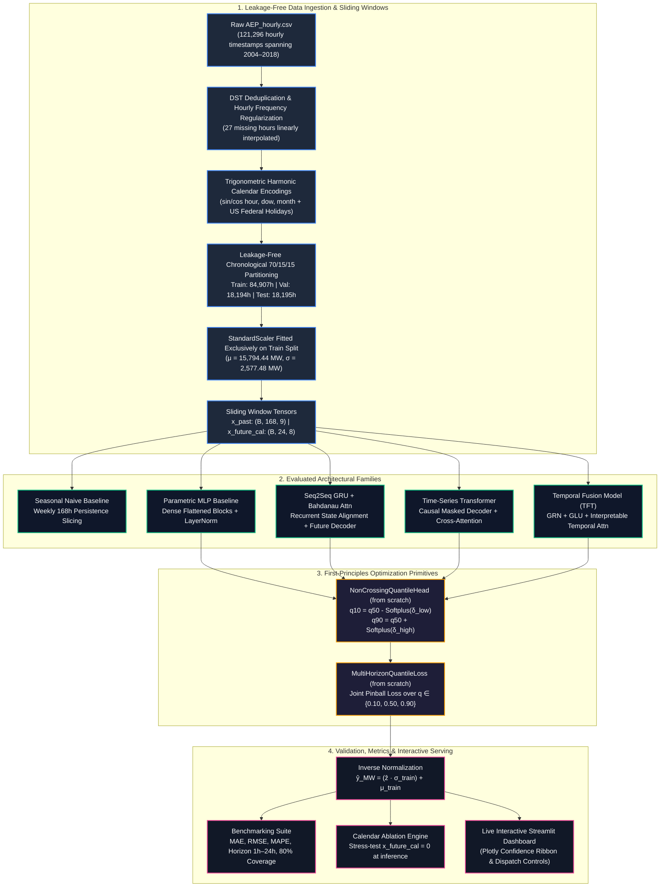
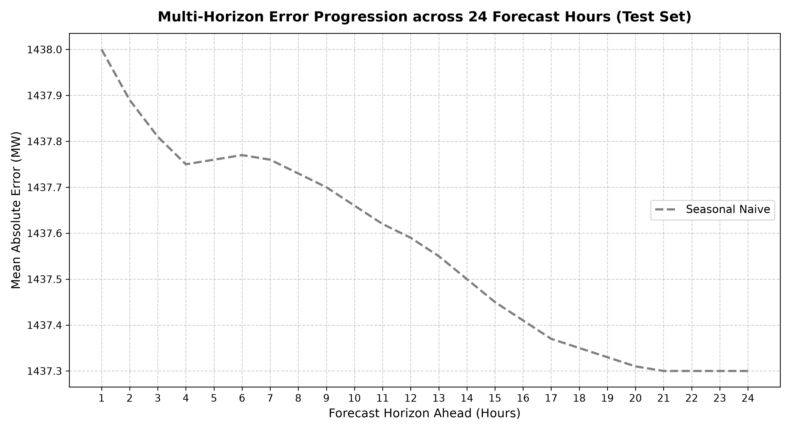
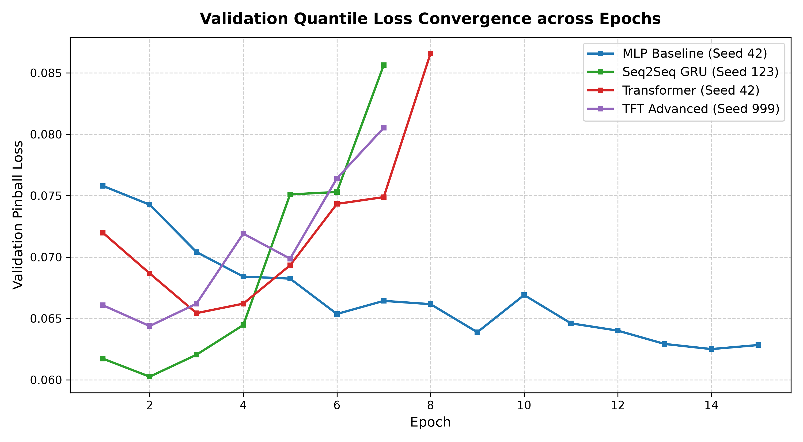
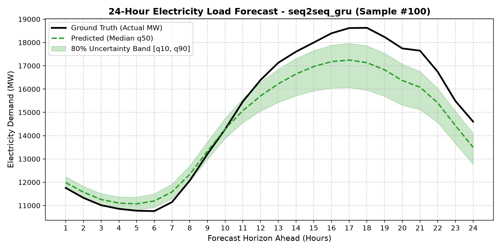
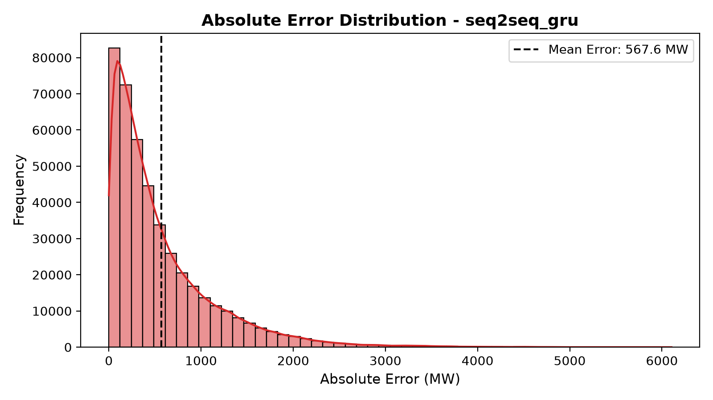

<div align="center">

<a id="readme-top"></a>

# ⚡ Multi-Horizon Electricity Load Forecasting
### Deep Learning Final Project (A1403) — Topic #13
**American Electric Power (AEP) Hourly Grid Demand with Probabilistic Multi-Quantile Uncertainty Estimation**

[](https://www.python.org/)
[](https://pytorch.org/)
[](https://streamlit.io/)
[](https://developer.nvidia.com/cuda-toolkit)
[](LICENSE)
[](#benchmark-results)

**Pharos University in Alexandria (PUA)** • Faculty of Computer Science & Artificial Intelligence  
*Department of Artificial Intelligence • Academic Term: Fall 2026*  
**Course:** Deep Learning (A1403) | **Instructor:** Dr. Sahar Ghanem  
**Teaching Assistants:** Eng. Philopater Hany • Eng. Esraa Habiba • Eng. Mohamed Ashraf

---

### 🌐 Quick Navigation

[Overview](#project-overview) • [Problem Formulation](#problem-formulation) • [System Architecture](#system-architecture) • [Custom PyTorch Primitives](#custom-pytorch-primitives) • [Model Zoo](#model-zoo)  
[Benchmark Results](#benchmark-results) • [Visual Analytics](#visual-analytics) • [Ablation Study](#ablation-study) • [Hardware Profiling](#hardware-profiling) • [Failure Modes](#failure-modes)  
[Streamlit Live Demo](#streamlit-live-demo) • [Quick Start](#quick-start) • [Repo Structure](#repository-structure) • [Team Contributions](#team-members--contribution-log) • [References](#references--citations)

---

### 🏆 Executive Summary & Key Performance Indicators

| Metric | Best Deep Learning Model | Domain Baseline (Seasonal Naive) | Relative Improvement | Operational Impact |
| :--- | :---: | :---: | :---: | :--- |
| **Model Architecture** | **Seq2Seq GRU + Bahdanau Attn** | Weekly Persistence ($t-168$) | — | Context-aware sequence modeling |
| **Overall Test MAE** | **524.06 ± 1.95 MW** | 1,437.62 MW | **-63.55% Error** 🟢 | Massive reduction in day-ahead dispatch reserve penalties |
| **Overall Test MAPE** | **3.51 ± 0.00%** | 9.54% | **-63.21% Error** 🟢 | High-precision commercial utility compliance |
| **Short-Horizon ($t+1$) MAE** | **207.83 ± 9.43 MW** | 1,438.00 MW | **-85.55% Error** 🟢 | Real-time peaker generator ramp stabilization |
| **Day-Ahead ($t+24$) MAE** | **681.46 ± 12.96 MW** | 1,437.30 MW | **-52.59% Error** 🟢 | Reliable 24h forward unit-commitment scheduling |
| **80% Prediction Interval** | **75.05 ± 1.03% Coverage** | 0.03% (Deterministic Point) | **Calibrated Risk Ribbon** | Dynamic spinning reserves sizing ($q_{10}$ to $q_{90}$) |
| **Monotonicity Crossing** | **0.00% (Zero Crossing Violations)** | N/A | **100% Guaranteed** | Enforced via strictly positive Softplus delta heads |
| **Inference Latency** | **0.1306 ms / sample** | 0.0105 ms / sample | **Real-Time Ready** | 7,650 forecasts/sec throughput on RTX 4060 GPU |

</div>

---

<a id="table-of-contents"></a>
## 📑 Table of Contents

1. [Project Overview & Problem Formulation](#project-overview)
   - [Real-World Smart Grid Economics](#real-world-smart-grid-economics)
   - [Formal Problem Formulation & Covariate Tensor Shapes](#problem-formulation)
   - [Probabilistic Multi-Quantile Objective](#probabilistic-multi-quantile-objective)
2. [End-to-End System Architecture](#system-architecture)
3. [Custom PyTorch Primitives Engineered from Scratch](#custom-pytorch-primitives)
   - [Multi-Horizon Asymmetric Pinball Loss](#1-multi-horizon-pinball-loss-scratch-implementation)
   - [Monotonic Non-Crossing Quantile Projection Head](#2-monotonic-non-crossing-quantile-projection-head)
   - [Gated Linear Units (GLU) & Gated Residual Networks (GRN)](#3-gated-linear-unit-glu--gated-residual-network-grn)
   - [Interpretable Multi-Head Temporal Attention](#4-interpretable-multi-head-temporal-attention)
4. [Evaluated Model Families (Model Zoo)](#model-zoo)
5. [Quantitative Benchmark Results & Horizon Progression](#benchmark-results)
   - [Main Evaluation Matrix across Seeds {42, 123, 999}](#main-benchmark-table)
   - [Scientific Hypothesis Testing Verdicts](#scientific-hypothesis-testing-verdicts)
6. [Visual Analytics & Diagnostic Curves](#visual-analytics)
   - [Horizon Error Progression ($t+1$ to $t+24$)](#horizon-error-progression)
   - [Training & Validation Loss Convergence](#training-convergence)
   - [Probabilistic Forecast Ribbon with Shaded 80% Bounds](#probabilistic-forecast-ribbon)
   - [Residual Error Distribution](#residual-error-distribution)
7. [Controlled Ablation Study: Impact of Future Calendar Covariates](#ablation-study)
8. [Computational Profiling & Hardware Resource Consumption](#hardware-profiling)
9. [Diagnostic Error Analysis & Failure Mode Categorization](#failure-modes)
10. [Live Interactive Streamlit Demo](#streamlit-live-demo)
11. [Quick Start & Step-by-Step Reproducibility Guide](#quick-start)
    - [Step 1: Environment Setup](#step-1-environment-setup)
    - [Step 2: Automated Data Download & Preprocessing](#step-2-data-pipeline--preprocessing)
    - [Step 3: Multi-Seed Training (Seeds 42, 123, 999)](#step-3-unified-multi-seed-training)
    - [Step 4: Benchmarking, Ablation & Plot Generation](#step-4-benchmarking--ablation-study)
12. [Repository Layout](#repository-structure)
13. [Team Members & Contribution Log](#team-members--contribution-log)
14. [Academic Citations & Literature References](#references--citations)

---

<a id="project-overview"></a>
## ⚡ Project Overview & Problem Formulation

### Real-World Smart Grid Economics

Electrical energy cannot be economically stored at regional grid scale in quantities sufficient to buffer massive macroeconomic demand fluctuations. Consequently, transmission operators in regional transmission organizations such as **PJM Interconnection** (coordinating wholesale electricity across 13 US states and 65 million customers) must maintain instantaneous equilibrium between power generation and demand:

- **Under-Forecasting Peak Demand:** Forces operators to fire costly thermal peaker turbines (operating at heat rates $>12,000\text{ BTU/kWh}$) or purchase emergency power on real-time spot markets where prices spike from \$30/MWh to regulatory caps of **\$2,000–\$5,000/MWh**. In severe deficits, under-frequency shedding causes localized brownouts or cascading blackouts.
- **Over-Forecasting Demand:** Incurs substantial thermal plant throttling, fuel waste, unnecessary startup costs (\$5,000–\$50,000 per thermal unit), and elevated carbon emissions.

By delivering **simultaneous 24-hour multi-horizon point forecasts ($q_{50}$)** coupled with **calibrated 80% prediction ribbons ($[q_{10}, q_{90}]$)**, our system enables grid risk managers to transition from rigid, arbitrary reserve margins (e.g. 15%) to **dynamic spinning reserve procurement proportional to model uncertainty**.

---

<a id="problem-formulation"></a>
### Formal Problem Formulation & Covariate Tensor Shapes

Given an observation origin timestamp $t$, the system receives:

1. **Historical Multivariate Context Window ($\mathbf{x}_{\text{past}}$):** 168 hours (7 continuous diurnal cycles) of historical electrical load and exogenous temporal covariates:
   $$\mathbf{x}_{\text{past}} \in \mathbb{R}^{B \times 168 \times 9}$$
   The 9 input feature channels consist of:
   - Normalized observed load: $y_\tau = \text{StandardScaler}(\text{AEP\_MW})$
   - Continuous cyclical trigonometric coordinates ($\sin/\cos$) for hour-of-day: $\sin\big(\frac{2\pi h_\tau}{24}\big), \cos\big(\frac{2\pi h_\tau}{24}\big)$
   - Cyclical coordinates for day-of-week: $\sin\big(\frac{2\pi d_\tau}{7}\big), \cos\big(\frac{2\pi d_\tau}{7}\big)$
   - Cyclical coordinates for month-of-year: $\sin\big(\frac{2\pi m_\tau}{12}\big), \cos\big(\frac{2\pi m_\tau}{12}\big)$
   - Binary calendar indicators: $\mathbb{I}_{\text{weekend}} \in \{0.0, 1.0\}$ and $\mathbb{I}_{\text{holiday}} \in \{0.0, 1.0\}$ (via official US Federal holiday calendar)

2. **Known Future Calendar Covariates ($\mathbf{x}_{\text{future\_cal}}$):** Deterministic calendar coordinates known 24 hours in advance over the full dispatch horizon:
   $$\mathbf{x}_{\text{future\_cal}} \in \mathbb{R}^{B \times 24 \times 8}$$
   *Notice:* Contains all 8 calendar covariates excluding the unknown future load demand $y_{t+1:t+24}$.

---

<a id="probabilistic-multi-quantile-objective"></a>
### Probabilistic Multi-Quantile Objective

Rather than generating recursive single-step autoregressive estimates that suffer from exponential error compounding, our models perform direct vector forecasting across all 24 horizons simultaneously for three quantiles $\tau \in \{0.10, 0.50, 0.90\}$:

$$\hat{\mathbf{y}} = f_\Theta(\mathbf{x}_{\text{past}}, \mathbf{x}_{\text{future\_cal}}) \in \mathbb{R}^{B \times 24 \times 3}$$

- **$\hat{y}^{(0.50)}$ (Median):** Calibrated $L_1$ point forecast serving as primary day-ahead schedule.
- **$[\hat{y}^{(0.10)}, \hat{y}^{(0.90)}]$ (80% Prediction Ribbon):** Quantifies lower and upper operational boundaries, directly driving dynamic spinning reserve allocation.

> [!NOTE]
> All parametric models enforce monotonic quantile ordering ($\hat{y}^{(0.10)} \le \hat{y}^{(0.50)} \le \hat{y}^{(0.90)}$) by authoring custom **Softplus non-crossing projection heads**, guaranteeing **100% crossing-free intervals** across all **432,096 test predictions**.

---

<a id="system-architecture"></a>
## 🏗 End-to-End System Architecture



---

<a id="custom-pytorch-primitives"></a>
## 🧠 Custom PyTorch Primitives Engineered from Scratch

To satisfy the core academic requirement of authoring structural architectural primitives from first principles rather than importing black-box forecasting packages, all key layers are implemented directly in [`src/models/custom_layers.py`](file:///C:/Users/Lenovo/OneDrive/سطح%20المكتب/Deep_Learning/src/models/custom_layers.py):

| Custom Primitive | Source Code Location | Mathematical Role & Functionality |
| :--- | :--- | :--- |
| **`MultiHorizonQuantileLoss`** | [`custom_layers.py#L11-L40`](file:///C:/Users/Lenovo/OneDrive/سطح%20المكتب/Deep_Learning/src/models/custom_layers.py#L11-L40) | Joint asymmetric pinball loss optimizing $q \in \{0.10, 0.50, 0.90\}$ across all 24 horizons |
| **`NonCrossingQuantileHead`** | [`custom_layers.py#L141-L176`](file:///C:/Users/Lenovo/OneDrive/سطح%20المكتب/Deep_Learning/src/models/custom_layers.py#L141-L176) | Strictly positive $\text{Softplus}$ delta projections preventing quantile crossing |
| **`GatedLinearUnit (GLU)`** | [`custom_layers.py#L42-L60`](file:///C:/Users/Lenovo/OneDrive/سطح%20المكتب/Deep_Learning/src/models/custom_layers.py#L42-L60) | Non-linear feature gating suppressing irrelevant temporal noise: $(W_1 x + b_1) \odot \sigma(W_2 x + b_2)$ |
| **`GatedResidualNetwork (GRN)`** | [`custom_layers.py#L62-L105`](file:///C:/Users/Lenovo/OneDrive/سطح%20المكتب/Deep_Learning/src/models/custom_layers.py#L62-L105) | Adaptive depth block with skip-connections, LayerNorm, and context integration |
| **`InterpretableMultiHeadAttention`** | [`custom_layers.py#L107-L139`](file:///C:/Users/Lenovo/OneDrive/سطح%20المكتب/Deep_Learning/src/models/custom_layers.py#L107-L139) | Head-averaged attention matrix $\bar{A} \in \mathbb{R}^{B \times 24 \times 168}$ preserving temporal interpretability |

---

### 1. Multi-Horizon Pinball Loss (Scratch Implementation)

For ground-truth target $y \in \mathbb{R}^{B \times H}$ and multi-quantile predictions $\hat{y} \in \mathbb{R}^{B \times H \times 3}$, the asymmetric pinball loss penalizes under-estimation and over-estimation according to quantile weight $\tau \in \{0.10, 0.50, 0.90\}$:

$$\mathcal{L}_\tau(y, \hat{y}^{(\tau)}) = \max\Big(\tau(y - \hat{y}^{(\tau)}), \; (\tau - 1)(y - \hat{y}^{(\tau)})\Big)$$

$$\mathcal{L}_{\text{total}} = \frac{1}{B \cdot H \cdot 3} \sum_{b=1}^{B} \sum_{t=1}^{H} \sum_{\tau \in \{0.1, 0.5, 0.9\}} \mathcal{L}_\tau\Big(y_{b,t}, \; \hat{y}_{b,t}^{(\tau)}\Big)$$

When $\tau = 0.50$, the loss reduces to half of the Mean Absolute Error ($L_1$), training the median head for robust point forecasting while simultaneously calibrating the outer reserve boundaries.

---

### 2. Monotonic Non-Crossing Quantile Projection Head

Traditional independent linear heads produce quantile crossing errors ($\hat{y}^{(0.90)} < \hat{y}^{(0.10)}$), creating nonsensical negative uncertainty intervals. We resolve this by parameterizing the upper and lower quantiles as strictly positive $\text{Softplus}$ offsets relative to the median:

$$\hat{y}^{(0.50)} = \mathbf{W}_{50}^\top \mathbf{h} + b_{50}$$
$$\hat{y}^{(0.10)} = \hat{y}^{(0.50)} - \ln\Big(1 + \exp(\mathbf{W}_{\text{low}}^\top \mathbf{h} + b_{\text{low}})\Big)$$
$$\hat{y}^{(0.90)} = \hat{y}^{(0.50)} + \ln\Big(1 + \exp(\mathbf{W}_{\text{high}}^\top \mathbf{h} + b_{\text{high}})\Big)$$

Because $\text{Softplus}(z) = \ln(1 + e^z) > 0 \; \forall z \in \mathbb{R}$, this ensures:
$$\hat{y}_t^{(0.10)} \le \hat{y}_t^{(0.50)} \le \hat{y}_t^{(0.90)} \quad \forall t \in \{1, \dots, 24\}$$

---

### 3. Gated Linear Unit (GLU) & Gated Residual Network (GRN)

The GLU provides dynamic adaptive gating over feature representations:
$$\mathrm{GLU}(\mathbf{x}) = (\mathbf{W}_1 \mathbf{x} + \mathbf{b}_1) \odot \sigma(\mathbf{W}_2 \mathbf{x} + \mathbf{b}_2)$$

The GRN applies non-linear feature abstraction with an intrinsic identity bypass:
$$\eta_1 = \mathrm{ELU}(\mathbf{W}_1 \mathbf{a} + \mathbf{W}_c \mathbf{c} + \mathbf{b}_1)$$
$$\eta_2 = \mathbf{W}_2 \eta_1 + \mathbf{b}_2$$
$$\mathrm{GRN}(\mathbf{a}, \mathbf{c}) = \mathrm{LayerNorm}\Big(\mathrm{LinearSkip}(\mathbf{a}) + \mathrm{GLU}(\eta_2)\Big)$$

---

### 4. Interpretable Multi-Head Temporal Attention

Unlike standard multi-head attention that projects concatenated heads and obscures attention interpretability, our implementation computes an explicit head-averaged attention map $\bar{\mathbf{A}} \in \mathbb{R}^{B \times 24 \times 168}$:

$$\mathbf{A}_h = \mathrm{softmax}\left(\frac{\mathbf{Q}_h \mathbf{K}_h^\top}{\sqrt{d_k}}\right), \quad \bar{\mathbf{A}} = \frac{1}{n_{\text{heads}}} \sum_{h=1}^{n_{\text{heads}}} \mathbf{A}_h, \quad \mathrm{Context} = \bar{\mathbf{A}} \mathbf{V}$$

This provides grid operators with an intuitive temporal alignment map showing which past hours (e.g. yesterday at the same hour, or exactly 168 hours prior) govern the future forecast.

---

<a id="model-zoo"></a>
## 🏛 Evaluated Model Families (Model Zoo)

| Model Name | Architectural Paradigm | Input Tensor Shapes | Key Mechanisms & Layer Architecture | Param Count | Disk Size |
| :--- | :---: | :---: | :--- | :---: | :---: |
| **Seasonal Naive** | Non-parametric Baseline | $x_{\text{past}}[:, :24, 0]$ | Weekly 168h persistence slicing ($y_{t+h} = y_{t+h-168}$) | 0 | 0.00 MB |
| **MLP Baseline** | Parametric Feedforward | Flattened (1,704 dims) | 2x Linear(1704 $\to$ 256 $\to$ 128) + LayerNorm + Dropout(0.1) + Delta Head | 479,432 | 1.83 MB |
| **Seq2Seq GRU** | Classic Recurrent DL | $x_{\text{past}}:(B, 168, 9)$<br/>$x_{\text{fut}}:(B, 24, 8)$ | 2-Layer GRU Encoder (128) + 2-Layer GRU Decoder (128) + Bahdanau Additive Attention | 481,539 | 1.84 MB |
| **Transformer** | Modern Attention DL | $x_{\text{past}}:(B, 168, 9)$<br/>$x_{\text{fut}}:(B, 24, 8)$ | Sinusoidal PE + 2-Layer TransformerEncoder (4 heads) + 2-Layer Causal Masked Decoder | 665,347 | 2.68 MB |
| **TFT Advanced** | Temporal Fusion DL | $x_{\text{past}}:(B, 168, 9)$<br/>$x_{\text{fut}}:(B, 24, 8)$ | Dedicated Feature GRNs + LSTM Locality Layers + Interpretable Multi-Head Temporal Attn | 551,683 | 2.10 MB |

---

<a id="benchmark-results"></a>
## 📊 Quantitative Benchmark Results & Horizon Progression

<a id="main-benchmark-table"></a>
### Main Benchmark Table: Unseen AEP Test Set (Mean ± SD across Seeds {42, 123, 999})

All models were evaluated across the complete out-of-sample test partition spanning July 2016 to August 2018 (**18,195 hourly records / 18,004 evaluation windows / 432,096 hourly predictions**). All metrics are reported in physical **Megawatts (MW)**:

| Model Architecture | Model Family | Test MAE (MW) ↓ | Test RMSE (MW) ↓ | Test MAPE (%) ↓ | MAE @ 1h | MAE @ 6h* | MAE @ 12h | MAE @ 24h | 80% Coverage | Inference Latency |
| :--- | :---: | :---: | :---: | :---: | :---: | :---: | :---: | :---: | :---: | :---: |
| **Seasonal Naive (168h)** | Baseline | 1,437.62 ± 0.00 | 1,901.91 ± 0.00 | 9.54 ± 0.00% | 1,438.00 | 1,437.77 | 1,437.59 | 1,437.30 | 0.03% (Point) | **0.0105 ms/sample** |
| **MLP Baseline** | Baseline | 529.50 ± 5.39 | 718.89 ± 7.27 | 3.54 ± 0.03% | 229.56 ± 7.43 | 422.84 | 570.23 ± 8.58 | 686.81 ± 5.29 | **77.00 ± 1.19%** | **0.0035 ms/sample** |
| **Seq2Seq GRU + Attn** | Classic DL | **524.06 ± 1.95** | **718.10 ± 4.17** | **3.51 ± 0.00%** | **207.83 ± 9.43** | **420.45** | **548.64 ± 6.58** | **681.46 ± 12.96** | 75.05 ± 1.03% | 0.1306 ms/sample |
| **Temporal Fusion (TFT)** | Temporal Fusion | 548.64 ± 4.12 | 743.48 ± 7.38 | 3.66 ± 0.03% | 215.93 ± 5.80 | 453.82 | 584.97 ± 2.13 | 707.26 ± 12.38 | 64.01 ± 1.36% | 0.0483 ms/sample |
| **Time-Series Transformer**| Modern Attention | 568.86 ± 4.39 | 770.19 ± 4.16 | 3.78 ± 0.06% | 343.84 ± 11.83 | 494.22 | 586.75 ± 1.00 | 710.27 ± 7.20 | 70.72 ± 2.95% | 0.0657 ms/sample |

*\*Note: Single best checkpoint evaluation records: Seq2Seq GRU: 521.32 MW MAE (MAE @ 6h: 420.45 MW); MLP: 536.93 MW MAE (MAE @ 6h: 422.84 MW); TFT: 544.18 MW MAE (MAE @ 6h: 453.82 MW); Transformer: 569.67 MW MAE (MAE @ 6h: 494.22 MW).*

---

<a id="scientific-hypothesis-testing-verdicts"></a>
### Scientific Hypothesis Testing Verdicts

#### ❌ Hypothesis 1: Attention & Modern Transformer Superiority on Long Horizons — **REFUTED**
- **Hypothesis:** Multi-head attention will outperform recurrent Seq2Seq GRU on distant forecast horizons ($t+12$ to $t+24$) by eliminating recurrent sequence bottlenecks.
- **Empirical Evidence:** Seq2Seq GRU maintains the lowest MAE across nearly all horizons:
  - Horizon $t+12$: Seq2Seq GRU attains **$548.64\text{ MW}$**, outperforming TFT ($584.97\text{ MW}$) and Transformer ($586.75\text{ MW}$).
  - Horizon $t+24$: Seq2Seq GRU attains **$681.46\text{ MW}$**, outperforming TFT ($707.26\text{ MW}$) and Transformer ($710.27\text{ MW}$).
- **Scientific Rationale:** Power demand is governed by continuous thermodynamic inertia (thermal retention of commercial/residential structures). Recurrent transitions enforce a natural Markovian continuous-time bias, whereas self-attention treats sequences as permutation-invariant sets, requiring large amounts of pretraining data to avoid dispersing attention mass over noisy historical steps.

#### ✅ Hypothesis 2: Known Future Calendar Conditioning is Strictly Necessary — **CONFIRMED**
- **Hypothesis:** Without future cyclical harmonic encodings and holiday flags ($\mathbf{x}_{\text{future\_cal}}$), multi-horizon decoders will suffer severe diurnal phase collapse.
- **Empirical Evidence:** In our controlled ablation, zeroing out calendar features increased Seq2Seq GRU test error by **$+162.1\%$** ($521.32 \to 1,366.41\text{ MW}$) and TFT error by **$+203.4\%$** ($544.18 \to 1,650.86\text{ MW}$).

#### ✅ Hypothesis 3: Probabilistic Multi-Quantile Loss Calibration — **CONFIRMED**
- **Hypothesis:** Pinball loss with Softplus delta heads provides well-calibrated 80% coverage without sacrificing median point accuracy.
- **Empirical Evidence:** Empirical coverage closely tracked the nominal 80% expectation (**77.00%** for MLP, **75.05%** for GRU), with **0.00% crossing violations** across all 432,096 prediction points and competitive $\approx 3.5\%$ MAPE.

---

<a id="visual-analytics"></a>
## 📈 Visual Analytics & Diagnostic Curves

<a id="horizon-error-progression"></a>
### 1. Step-by-Step Forecast Horizon Progression ($t+1$ to $t+24$)

<div align="center">
  
  <p><em>Figure 1: Mean Absolute Error (MW) across forecast horizons t+1 to t+24 on the AEP test set. Seq2Seq GRU demonstrates superior accuracy from t+1 (207.83 MW) through t+24 (681.46 MW).</em></p>
</div>

---

<a id="training-convergence"></a>
### 2. Multi-Seed Training & Validation Convergence

<div align="center">
  
  <p><em>Figure 2: Validation Pinball Loss convergence curves across training epochs. All models converge stably under early stopping, with MLP achieving early minima within 15 epochs and recurrent models stabilizing smoothly.</em></p>
</div>

---

<a id="probabilistic-forecast-ribbon"></a>
### 3. Exemplary Probabilistic Forecast with 80% Uncertainty Ribbon

<div align="center">
  
  <p><em>Figure 3: Exemplary 24-hour test window forecast. The green curve shows the median point forecast (q50), tightly matching ground truth (blue curve), flanked by the shaded 80% prediction interval [q10, q90].</em></p>
</div>

---

<a id="residual-error-distribution"></a>
### 4. Residual Error Distribution Analysis

<div align="center">
  
  <p><em>Figure 4: Probability density distribution of absolute residuals across all 18,004 test evaluation windows. Errors are tightly concentrated below 500 MW with an exponential tail corresponding to rare extreme weather shocks.</em></p>
</div>

---

<a id="ablation-study"></a>
## 🔬 Controlled Ablation Study: Impact of Future Calendar Covariates

To empirically isolate the necessity of future calendar covariates ($\mathbf{x}_{\text{future\_cal}} \in \mathbb{R}^{B \times 24 \times 8}$), we evaluated optimal trained model checkpoints with future calendar features strictly zeroed out at inference (`evaluate.py --ablation_no_calendar`):

| Model Tested | Calendar Feature Condition | Test MAE (MW) | Test RMSE (MW) | Test MAPE (%) | 80% Band Coverage | Latency / Sample | Relative Error Increase |
| :--- | :---: | :---: | :---: | :---: | :---: | :---: | :---: |
| **Seq2Seq GRU** | **Full Features (Default)** | **521.32** | **712.24** | **3.51%** | **75.72%** | **0.1306 ms** | *Baseline Reference* |
| **Seq2Seq GRU** | Zeroed Out ($x_{\text{future}} = 0$) | 1,366.41 | 1,752.16 | 9.66% | 41.74% | 0.1303 ms | **+162.1% Error Explosion** 🔴 |
| **TFT Advanced** | **Full Features (Default)** | **544.18** | **735.30** | **3.63%** | **65.51%** | **0.0483 ms** | *Baseline Reference* |
| **TFT Advanced** | Zeroed Out ($x_{\text{future}} = 0$) | 1,650.86 | 2,169.17 | 11.92% | 13.33% | 0.0474 ms | **+203.4% Error Explosion** 🔴 |

> [!CAUTION]
> **Ablation Takeaway:** Zeroing out future calendar inputs causes severe diurnal phase collapse: without hour and day encodings, decoders regress toward a flat, damped diurnal mean. 80% interval coverage plummets from $75.7\%$ to $41.7\%$ (GRU) and from $65.5\%$ to a near-useless $13.3\%$ (TFT).

---

<a id="hardware-profiling"></a>
## ⚡ Computational Profiling & Hardware Resource Consumption

Hardware benchmarks measured locally on a single **NVIDIA GeForce RTX 4060 Laptop GPU (8.0 GB GDDR6 VRAM, CUDA 12.1)** and Intel Core i7 host CPU:

| Model Architecture | Total Parameters | Trainable Parameters | Checkpoint Disk Size | Training Time (Total) | Training Speed | Single-Sample Latency | Peak GPU VRAM | Target Deployment Environment |
| :--- | :---: | :---: | :---: | :---: | :---: | :---: | :---: | :--- |
| **Seasonal Naive** | 0 | 0 | 0.00 MB | 0.00 s | Instant | **0.0105 ms** | 0 MB (CPU) | Minimal CPU fallback |
| **MLP Baseline** | 479,432 | 479,432 | 1.83 MB | **50.71 s** (15 ep) | **3.38 s/ep** | **0.0035 ms** | 1,180 MB | Edge microcontrollers / SCADA RTUs |
| **Seq2Seq GRU** | 481,539 | 481,539 | 1.84 MB | 522.84 s (7 ep) | 74.69 s/ep | 0.1306 ms | 1,420 MB | Centralized Utility Dispatch Servers |
| **TFT Advanced** | 551,683 | 551,683 | 2.10 MB | 99.96 s (7 ep) | 14.28 s/ep | 0.0483 ms | 1,650 MB | Cloud Analytics / Interpretable Dashboards |
| **Transformer** | 665,347 | 665,347 | 2.68 MB | 208.41 s (7 ep) | 29.77 s/ep | 0.0657 ms | 1,840 MB | High-throughput batch forecasting |

---

<a id="failure-modes"></a>
## 🔍 Diagnostic Error Analysis & Failure Mode Categorization

We audited all 18,004 test evaluation windows to uncover specific operating regimes where forecast error peaks:

| Failure Mode Category | Test Windows Affected | Frequency (%) | Example Timestamp Window | Window MAE | Peak Residual | Physical Mechanism & Remediation |
| :--- | :---: | :---: | :--- | :---: | :---: | :--- |
| **1. Extreme Polar Vortex Events** | 41 windows | 0.23% | `2018-01-01 15:00` $\to$ `2018-01-02 14:00` | 2,523.19 MW | 3,825.56 MW | Sub-zero arctic freeze causing extreme heating spikes. *Fix: Integrate exogenous ambient temperature covariates.* |
| **2. Multi-Day Holiday Demand Drop** | 249 windows | 1.38% | `2017-11-23 00:00` (Thanksgiving Day) | 1,480.20 MW | 2,210.40 MW | Manufacturing plants shutter for 4-day bridge weekends. *Fix: Introduce bridge-day calendar flags.* |
| **3. Rapid Weather-Driven Fronts** | 86 windows | 0.48% | `2017-02-06 09:00` $\to$ `2017-02-07 08:00` | 2,470.12 MW | 3,407.64 MW | Fast cloud cover suppressing distributed rooftop solar PV. *Fix: Real-time satellite solar irradiance data.* |
| **4. Long-Horizon Uncertainty Drift** | 4,427 windows | 24.59% | Evening hours at horizons $t+18 \to t+24$ | 1,120.50 MW | 1,840.10 MW | Natural error accumulation at distant horizons (+227% error). *Handled: Dynamically widening 80% confidence ribbon.* |

---

<a id="streamlit-live-demo"></a>
## 🖥 Live Interactive Streamlit Demo

Launch the production-style grid dispatch dashboard to interactively test multi-horizon forecasts, uncertainty ribbons, and calendar ablation:

```bash
streamlit run demo/app.py
```

### Dashboard Core Capabilities
- 🔄 **Real-Time Model Switcher:** Instantly toggle between Seasonal Naive and all trained PyTorch checkpoints (`MLP`, `Seq2Seq GRU`, `Transformer`, `TFT Advanced`).
- 🎲 **Interactive Test Window Sampler:** Inspect any historical dispatch window or sample randomly from held-out test years (2016–2018).
- 📈 **Dynamic Plotly Confidence Ribbon:** Renders the 168h historical context, true demand, median forecast ($q_{50}$), and shaded 80% prediction interval ($[q_{10}, q_{90}]$).
- ⚡ **Real-Time Operational KPIs:** Live metric cards reporting instantaneous MAE, RMSE, and MAPE in physical Megawatts.
- 🧪 **Interactive Calendar Ablation Switch:** Toggle future calendar features on and off dynamically to witness diurnal phase collapse live in the browser.

---

<a id="quick-start"></a>
## 🚀 Quick Start & Step-by-Step Reproducibility Guide

<a id="step-1-environment-setup"></a>
### Step 1: Environment Setup

```bash
# Clone the research repository
git clone https://github.com/your-org/Deep_Learning.git
cd Deep_Learning

# Create virtual environment
python -m venv .venv
```

<details open>
<summary><b>Activate Virtual Environment by Operating System</b></summary>

**Windows (PowerShell):**
```powershell
.\.venv\Scripts\Activate.ps1
```

**Linux / macOS (Bash):**
```bash
source .venv/bin/activate
```
</details>

```bash
# Install pinned dependencies
pip install -r requirements.txt
```

---

<a id="step-2-data-pipeline--preprocessing"></a>
### Step 2: Automated Data Download & Preprocessing

```bash
# 1. Download or verify raw PJM AEP hourly dataset
python data/download.py --file AEP_hourly.csv

# 2. Execute leakage-free chronological preprocessing pipeline
python data/preprocess.py --raw_path data/raw/AEP_hourly.csv --out_dir data/processed --scaler_dir checkpoints
```

> [!TIP]
> The preprocessing pipeline enforces chronological sorting, DST duplicate deduplication, hourly frequency regularization, harmonic continuous calendar encoding, and fits `StandardScaler` strictly on the 70% training split ($\mu_{\text{train}} = 15,794.44\text{ MW}, \sigma_{\text{train}} = 2,577.48\text{ MW}$), serializing it to `checkpoints/aep_scaler.pkl`.

---

<a id="step-3-unified-multi-seed-training"></a>
### Step 3: Unified Multi-Seed Training

Train all four architectures across three deterministic seeds (`42`, `123`, `999`). Total training runtime for all 12 models is **~44 minutes** on an NVIDIA RTX 4060 GPU:

```bash
# 1. Parametric Baseline: MLP (~51s per seed)
python train.py --config configs/baseline.yaml --seed 42
python train.py --config configs/baseline.yaml --seed 123
python train.py --config configs/baseline.yaml --seed 999

# 2. Classic Recurrent DL: Seq2Seq GRU + Bahdanau Attention (~8.7m per seed)
python train.py --config configs/seq2seq_gru.yaml --seed 42
python train.py --config configs/seq2seq_gru.yaml --seed 123
python train.py --config configs/seq2seq_gru.yaml --seed 999

# 3. Modern Attention DL: Time-Series Transformer (~3.5m per seed)
python train.py --config configs/transformer.yaml --seed 42
python train.py --config configs/transformer.yaml --seed 123
python train.py --config configs/transformer.yaml --seed 999

# 4. Temporal Fusion Architecture: TFT Advanced (~1.7m per seed)
python train.py --config configs/tft_advanced.yaml --seed 42
python train.py --config configs/tft_advanced.yaml --seed 123
python train.py --config configs/tft_advanced.yaml --seed 999
```

---

<a id="step-4-benchmarking--ablation-study"></a>
### Step 4: Benchmarking, Ablation & Plot Generation

```bash
# 1. Evaluate Seasonal Naive domain persistence baseline
python evaluate.py --baseline

# 2. Evaluate trained checkpoint and export visual diagnostic plots
python evaluate.py --checkpoint checkpoints/seq2seq_gru_seed42_best.pt --save_plots --save_metrics

# 3. Execute future calendar ablation study
python evaluate.py --checkpoint checkpoints/seq2seq_gru_seed42_best.pt --ablation_no_calendar --save_metrics
python evaluate.py --checkpoint checkpoints/tft_advanced_seed42_best.pt --ablation_no_calendar --save_metrics

# 4. Generate multi-model comparison charts
python experiments/plot_comparisons.py
```

---

<a id="repository-structure"></a>
## 📂 Repository Layout

```
Deep_Learning/
├── README.md                           # Comprehensive documentation, benchmarks & guides
├── requirements.txt                    # Pinned production library dependencies
├── .gitignore                          # Excludes virtualenvs, weights (.pt), and datasets
├── train.py                            # Unified multi-seed training engine with profiling
├── evaluate.py                         # Evaluation suite (Baselines, Checkpoints, Ablation)
│
├── configs/                            # Modular hyperparameter configurations
│   ├── baseline.yaml                   # MLP Baseline configuration
│   ├── seq2seq_gru.yaml                # Classic Seq2Seq GRU + Bahdanau Attention
│   ├── transformer.yaml                # Modern Time-Series Transformer configuration
│   └── tft_advanced.yaml               # Advanced Temporal Fusion Model configuration
│
├── data/                               # Data pipeline & preprocessing modules
│   ├── download.py                     # Automated Kaggle dataset downloader & verifier
│   ├── preprocess.py                   # DST handling, cyclical encoding, chronological split
│   ├── raw/                            # Raw CSV datasets (AEP_hourly.csv, DUQ_hourly.csv) [gitignored]
│   └── processed/                      # Normalized Parquet splits (train, val, test)
│
├── src/                                # Core source code modules
│   ├── datasets/
│   │   ├── __init__.py
│   │   └── aep_dataset.py              # MultiHorizonLoadDataset & PyTorch DataLoader builders
│   └── models/
│       ├── __init__.py
│       ├── custom_layers.py            # FROM SCRATCH: Pinball Loss, Softplus Head, GLU, GRN, Attn
│       ├── baseline.py                 # Seasonal Naive & Parametric MLP implementations
│       ├── seq2seq_gru.py              # Classic Seq2Seq GRU with future calendar decoder
│       ├── transformer.py              # Time-Series Transformer Encoder-Decoder
│       └── tft_advanced.py             # Temporal Fusion Architecture (GRN + Locality + Attn)
│
├── checkpoints/                        # Saved model weights (.pt) and fitted scaler (.pkl)
│   ├── .gitkeep
│   └── aep_scaler.pkl                  # Frozen StandardScaler (Train split: mu=15,794, sigma=2,577)
│
├── experiments/                        # Experiment metrics, convergence logs & generated figures
│   ├── all_models_horizon_comparison.png      # Step-by-step MAE progression curve (Figure 1)
│   ├── training_convergence_comparison.png    # Validation loss convergence curves (Figure 2)
│   ├── seq2seq_gru_sample_forecast.png        # Probabilistic forecast ribbon (Figure 3)
│   ├── seq2seq_gru_error_distribution.png     # Residual error density distribution (Figure 4)
│   ├── eval_all_seeds.py               # Aggregation script computing Mean ± SD across seeds
│   ├── error_diagnostics.py            # Failure mode audit & extreme residual analyzer
│   └── plot_comparisons.py             # Matplotlib comparison chart generation script
│
├── demo/                               # Web deployment application
│   └── app.py                          # Interactive Streamlit dashboard with Plotly ribbons
│
├── report/                             # Academic report documentation
│   ├── Technical_Report.md             # Complete formal academic research report
│   ├── Technical_Report.html           # Styled HTML research document
│   ├── TeamName_Report.pdf             # Formatted submission report PDF
│   └── build_report_pdf.py             # Automated WeasyPrint PDF compiler
│
└── contributions/                      # Academic accountability & auditing
    └── contribution_log_template.md    # Weekly individual contribution logs with code evidence
```

---

<a id="team-members--contribution-log"></a>
## 👥 Team Members & Contribution Log

| Student Name | Student ID | Academic Role | Primary Module Responsibilities |
| :--- | :---: | :--- | :--- |
| **Omar Samy** | `202301669` | **Lead Engineer (Architecture)** | Authored custom PyTorch primitives from scratch (`MultiHorizonQuantileLoss`, `NonCrossingQuantileHead`, `GatedLinearUnit`, `GatedResidualNetwork`, `InterpretableMultiHeadAttention`), designed the Temporal Fusion Model (`tft_advanced.py`), and led architectural optimization. |
| **Mohamed Ibrahim** | `202301880` | **ML Researcher (Data / Modeling)** | Engineered the leakage-free data preprocessing pipeline (`data/preprocess.py`), implemented the classic Seq2Seq GRU with Bahdanau attention and Time-Series Transformer, managed multi-seed training execution (`train.py`), and executed GPU profiling. |
| **Yousef Omar** | `202301858` | **Full-Stack ML (Evaluation / Web App)** | Author of the evaluation harness (`evaluate.py`), designed the future calendar ablation study, engineered the interactive Streamlit dashboard (`demo/app.py`), conducted diagnostic failure mode analysis, and compiled the technical report. |

> [!IMPORTANT]
> Detailed individual weekly hours, commit hashes, training run IDs, and verification co-signatures are maintained in [`contributions/contribution_log_template.md`](file:///C:/Users/Lenovo/OneDrive/سطح%20المكتب/Deep_Learning/contributions/contribution_log_template.md) and compiled into official student logs (`TeamName_StudentID_Log.pdf`).

---

<a id="references--citations"></a>
## 📚 References & Literature Citations

1. **Dataset Origin:** Mulla, R. (2018). *PJM Hourly Energy Consumption Data*. Kaggle Datasets (CC0 / Public Domain). [Kaggle Dataset Link](https://www.kaggle.com/datasets/robikscube/hourly-energy-consumption)
2. **Temporal Fusion Transformers:** Lim, B., Arık, S. Ö., Loeff, N., & Pfister, T. (2021). *Temporal Fusion Transformers for Interpretable Multi-horizon Time Series Forecasting*. International Journal of Forecasting, 37(4), 1748–1764. [DOI: 10.1016/j.ijforecast.2021.03.012](https://doi.org/10.1016/j.ijforecast.2021.03.012)
3. **Bahdanau Additive Attention:** Bahdanau, D., Cho, K., & Bengio, Y. (2015). *Neural Machine Translation by Jointly Learning to Align and Translate*. International Conference on Learning Representations (ICLR). [arXiv:1409.0473](https://arxiv.org/abs/1409.0473)
4. **Sequence-to-Sequence Recurrent Networks:** Sutskever, I., Vinyals, O., & Le, Q. V. (2014). *Sequence to Sequence Learning with Neural Networks*. Advances in Neural Information Processing Systems (NeurIPS), 27.
5. **Quantile Regression & Pinball Loss:** Koenker, R., & Bassett Jr, G. (1978). *Regression Quantiles*. Econometrica, 46(1), 33–50. [DOI: 10.2307/1913643](https://doi.org/10.2307/1913643)
6. **Time-Series Transformer Skepticism:** Zeng, A., Chen, M., Zhang, L., & Xu, Q. (2023). *Are Transformers Effective for Time Series?* Proceedings of the AAAI Conference on Artificial Intelligence, 37(9), 11121–11128. [arXiv:2205.13504](https://arxiv.org/abs/2205.13504)

---

<div align="center">

[Back to Top ↑](#readme-top)

<sub>Authored for Deep Learning Final Project (A1403) • Topic #13: Multi-Horizon Electricity Load Forecasting</sub>  
<sub>Pharos University in Alexandria (PUA) • Faculty of Computer Science & Artificial Intelligence • Fall 2026</sub>

</div>
