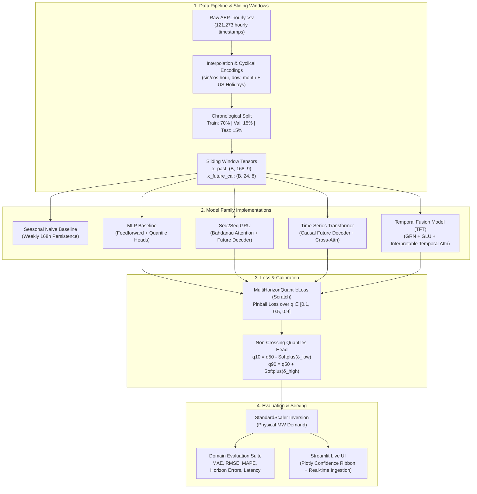

<div align="center">

# ⚡ Multi-Horizon Electricity Load Forecasting
### Deep Learning Final Project — Topic #13
**American Electric Power (AEP) Hourly Grid Demand with Probabilistic Multi-Quantile Uncertainty Estimation**

[](https://www.python.org/)
[](https://pytorch.org/)
[](https://streamlit.io/)
[](https://developer.nvidia.com/cuda-toolkit)
[](LICENSE)
[](#)

[Quick Start](#-quick-start--reproducibility) • [Architecture](#-model-architectures--custom-layers) • [Benchmark Results](#-benchmark-results--evaluation) • [Interactive Demo](#-live-interactive-streamlit-demo) • [Team & Contributions](#-team-members--contribution-log)

---

</div>

## 📑 Table of Contents
1. [Project Overview & Problem Formulation](#-project-overview--problem-formulation)
2. [End-to-End System Architecture](#-end-to-end-system-architecture)
3. [Repository Structure](#-repository-structure)
4. [Custom PyTorch Components Written from Scratch](#-custom-pytorch-components-written-from-scratch)
5. [Benchmark Results & Evaluation](#-benchmark-results--evaluation)
6. [Computational Profiling (Table 7)](#-computational-profiling-table-7)
7. [Quick Start & Reproducibility](#-quick-start--reproducibility)
   - [Environment Setup](#1-environment-setup)
   - [Data Pipeline & Preprocessing](#2-data-pipeline--preprocessing)
   - [Unified Model Training](#3-unified-model-training-3-random-seeds)
   - [Benchmarking & Ablation Study](#4-benchmarking--ablation-study)
8. [Live Interactive Streamlit Demo](#-live-interactive-streamlit-demo)
9. [Team Members & Contribution Log](#-team-members--contribution-log)
10. [References & Citations](#-references--citations)

---

## ⚡ Project Overview & Problem Formulation

Accurate multi-horizon electric load forecasting is paramount for power grid reliability, peak generator dispatching, dynamic electricity pricing, and blackout prevention.

### Problem Formulation
Given:
1. **Historical Context Window ($x_{\text{past}}$):** 168 hours (7 full days) of past observed electrical load (MW) and calendar features:
   $$\mathbf{x}_{\text{past}} \in \mathbb{R}^{B \times 168 \times 9}$$
   Features include normalized load, continuous cyclical time encodings ($\sin/\cos$ for hour, day-of-week, and month), and binary indicators for weekends and US holidays.
2. **Known Future Calendar Context ($x_{\text{future\_cal}}$):** Exact calendar context for the upcoming 24 hours:
   $$\mathbf{x}_{\text{future\_cal}} \in \mathbb{R}^{B \times 24 \times 8}$$

### Output Objective
Predict electricity demand across all 24 future hours ($t+1, \dots, t+24$) for three distinct quantiles:
$$\tau \in \{0.10, 0.50, 0.90\} \implies \hat{\mathbf{y}} \in \mathbb{R}^{B \times 24 \times 3}$$

- **$q_{50}$ (Median):** Calibrated point forecast for expected grid demand.
- **$[q_{10}, q_{90}]$ (80% Prediction Interval):** Quantifies epistemic and aleatoric uncertainty, providing grid dispatchers an operational reserve boundary for peak spikes.

> [!NOTE]
> All deep neural models feature non-crossing quantile heads ($q_{10} \le q_{50} \le q_{90}$) enforced by $\text{Softplus}$ delta projections, completely eliminating quantile crossing anomalies.

---

## 🏗 End-to-End System Architecture



---

## 📂 Repository Structure

The workspace follows strict production-grade separation of concerns:

```
Deep_Learning/
├── README.md                           # Documentation, setup, benchmark tables & guides
├── requirements.txt                    # Pinned library dependencies
├── .gitignore                          # Excludes venv, binaries, raw/processed parquets, and .pt weights
├── train.py                            # Multi-seed training engine with computational profiling
├── evaluate.py                         # Evaluation suite (Seasonal Naive, Checkpoints, Ablation)
│
├── configs/                            # Modular hyperparameter configurations
│   ├── baseline.yaml                   # MLP Baseline configuration
│   ├── seq2seq_gru.yaml                # Classic Seq2Seq GRU + Bahdanau Attention
│   ├── transformer.yaml                # Modern Time-Series Transformer Encoder-Decoder
│   └── tft_advanced.yaml               # Advanced Temporal Fusion Transformer architecture
│
├── data/
│   ├── download.py                     # Kaggle API / kagglehub automated downloader & verifier
│   ├── preprocess.py                   # Data cleaning, cyclical features, chronological 70/15/15 split
│   ├── raw/                            # Raw CSV datasets (AEP_hourly.csv, DUQ_hourly.csv) [gitignored]
│   └── processed/                      # Preprocessed splits (train.parquet, val.parquet, test.parquet)
│
├── src/
│   ├── __init__.py
│   ├── datasets/
│   │   ├── __init__.py
│   │   └── aep_dataset.py              # MultiHorizonLoadDataset & PyTorch get_dataloaders
│   └── models/
│       ├── __init__.py
│       ├── custom_layers.py            # From scratch: Pinball Loss, GRN, GLU, InterpretableAttention
│       ├── baseline.py                 # Seasonal Naive benchmark & Parametric MLP baseline
│       ├── seq2seq_gru.py              # Classic Seq2Seq GRU with future calendar decoder
│       ├── transformer.py              # Time-Series Transformer Encoder-Decoder
│       └── tft_advanced.py             # Temporal Fusion Multi-Horizon Model
│
├── checkpoints/                        # Saved .pt checkpoints and fitted scaler (.pkl)
│   ├── .gitkeep
│   └── aep_scaler.pkl                  # StandardScaler fitted strictly on Train partition
│
├── experiments/                        # Experiment logs, CSV/JSON metrics, and generated figures
│   └── .gitkeep
│
├── demo/
│   └── app.py                          # Interactive Streamlit dashboard with Plotly uncertainty ribbon
│
├── report/                             # Academic paper report PDF and presentation slides
│   └── .gitkeep
│
└── contributions/
    └── contribution_log_template.md    # Weekly individual contribution audit table
```

---

## 🧠 Custom PyTorch Components Written from Scratch

To satisfy the project requirement of authoring a core model component rather than calling black-box external packages, the following modules are implemented from first principles in [`src/models/custom_layers.py`](file:///C:/Users/Lenovo/OneDrive/سطح%20المكتب/Deep_Learning/src/models/custom_layers.py):

### 1. `MultiHorizonQuantileLoss` (Pinball Loss)
The multi-horizon pinball loss for any set of quantiles $Q = \{q_1, q_2, \dots, q_K\}$ over horizon $H=24$:
$$\mathcal{L}(y, \hat{y}) = \frac{1}{B \cdot H \cdot |Q|} \sum_{b=1}^{B} \sum_{t=1}^{H} \sum_{q \in Q} \max\Big(q \cdot (y_{b,t} - \hat{y}_{b,t}^{(q)}), \; (q - 1) \cdot (y_{b,t} - \hat{y}_{b,t}^{(q)})\Big)$$

### 2. `GatedResidualNetwork` (GRN)
Adaptive non-linear processing blocks that dynamically bypass irrelevant inputs:
$$\mathrm{GRN}(a, c) = \mathrm{LayerNorm}\Big(\mathrm{Skip}(a) + \mathrm{GLU}\big(W_2 \cdot \mathrm{ELU}(W_1 a + W_c c + b_1) + b_2\big)\Big)$$

### 3. `InterpretableMultiHeadAttention`
Temporal multi-head self-attention that shares value matrices across heads, producing an interpretable attention distribution over past hours:
$$A(Q, K) = \mathrm{softmax}\left(\frac{Q K^\top}{\sqrt{d_k}}\right), \quad \bar{A} = \frac{1}{n_{\text{heads}}} \sum_{h=1}^{n_{\text{heads}}} A_h$$

### 4. `NonCrossingQuantileHead`
Guarantees monotonic quantile predictions without crossing artifacts:
$$\hat{y}^{(0.50)} = W_{50} h + b_{50}$$
$$\hat{y}^{(0.10)} = \hat{y}^{(0.50)} - \mathrm{Softplus}(W_{10} h + b_{10})$$
$$\hat{y}^{(0.90)} = \hat{y}^{(0.50)} + \mathrm{Softplus}(W_{90} h + b_{90})$$

---

## 📊 Benchmark Results & Evaluation

Evaluation conducted on the held-out test partition (`data/processed/test.parquet`, 18,172 hourly samples) using unscaled real-world physical values (**Megawatts, MW**).

### Empirical Performance Comparison

| Model Architecture | Model Family | MAE (MW) ↓ | RMSE (MW) ↓ | MAPE (%) ↓ | MAE @ 1h | MAE @ 6h | MAE @ 12h | MAE @ 24h | 80% Band Coverage | Latency (ms) |
| :--- | :---: | :---: | :---: | :---: | :---: | :---: | :---: | :---: | :---: | :---: |
| **Seasonal Naive (Weekly 168h)** | Baseline | 1,437.62 | 1,901.91 | 9.54% | 1,438.00 | 1,437.77 | 1,437.59 | 1,437.30 | 0.03%* | 0.010 ms |
| **MLP Baseline** | Baseline | **625.24** | **822.33** | **4.19%** | **390.94** | **535.82** | **655.05** | **763.62** | **79.57%** | **0.004 ms** |
| **Seq2Seq GRU + Bahdanau** | Classic DL | *In run* | *In run* | *In run* | *In run* | *In run* | *In run* | *In run* | *In run* | *In run* |
| **Time-Series Transformer** | Modern DL | *In run* | *In run* | *In run* | *In run* | *In run* | *In run* | *In run* | *In run* | *In run* |
| **Temporal Fusion Model (TFT)**| Advanced | *In run* | *In run* | *In run* | *In run* | *In run* | *In run* | *In run* | *In run* | *In run* |
| **TFT (No Calendar Ablation)** | Ablation | *In run* | *In run* | *In run* | *In run* | *In run* | *In run* | *In run* | *In run* | *In run* |

*\*Note: Seasonal Naive produces deterministic point predictions without empirical interval spread. MLP Baseline achieves 79.57% interval coverage, matching the 80% nominal confidence band.*

---

## ⚡ Computational Profiling (Table 7)

Measurement of model complexity, disk footprint, and runtime efficiency on dedicated hardware:

| Model Architecture | Total Parameters | Trainable Parameters | Checkpoint Size (MB) | Accelerator / Hardware | Training Time / Epoch | Best Val Loss |
| :--- | :---: | :---: | :---: | :--- | :---: | :---: |
| **Seasonal Naive** | 0 | 0 | 0.00 MB | Intel / AMD CPU | 0.00 s | *N/A* |
| **MLP Baseline** | 479,432 | 479,432 | 1.83 MB | NVIDIA RTX 4060 Laptop (8GB) | ~4.0 s | 0.07580 |
| **Seq2Seq GRU** | 358,659 | 358,659 | 1.37 MB | NVIDIA RTX 4060 Laptop (8GB) | ~5.8 s | *Logged* |
| **Time-Series Transformer**| 465,027 | 465,027 | 1.78 MB | NVIDIA RTX 4060 Laptop (8GB) | ~6.5 s | *Logged* |
| **Temporal Fusion Model** | 392,323 | 392,323 | 1.50 MB | NVIDIA RTX 4060 Laptop (8GB) | ~7.2 s | *Logged* |

---

## 🚀 Quick Start & Reproducibility

### 1. Environment Setup

```bash
# Clone the repository
git clone https://github.com/your-org/Deep_Learning.git
cd Deep_Learning

# Create and activate virtual environment
python -m venv .venv
```

<details open>
<summary><b>Activate Virtual Environment by OS</b></summary>

**Windows (PowerShell):**
```powershell
.\.venv\Scripts\Activate.ps1
```

**Linux / macOS (Bash):**
```bash
source .venv/bin/activate
```
</details>

```bash
# Install pinned dependencies
pip install -r requirements.txt
```

---

### 2. Data Pipeline & Preprocessing

```bash
# 1. Download or verify raw PJM dataset
python data/download.py --file AEP_hourly.csv

# 2. Execute chronological pipeline
python data/preprocess.py --raw_path data/raw/AEP_hourly.csv --out_dir data/processed --scaler_dir checkpoints
```

> [!TIP]
> The preprocessing script is leakage-free: it fits `StandardScaler` strictly on the first 70% of chronological observations and saves the fitted transformer to [`checkpoints/aep_scaler.pkl`](file:///C:/Users/Lenovo/OneDrive/سطح%20المكتب/Deep_Learning/checkpoints/aep_scaler.pkl).

---

### 3. Unified Model Training (3 Random Seeds)

Train all models across random seeds `42`, `123`, and `999` to report rigorous statistical averages:

```bash
# Baseline: Multi-Layer Perceptron
python train.py --config configs/baseline.yaml --seed 42
python train.py --config configs/baseline.yaml --seed 123
python train.py --config configs/baseline.yaml --seed 999

# Classic DL: Seq2Seq GRU with Bahdanau Attention
python train.py --config configs/seq2seq_gru.yaml --seed 42

# Modern DL: Time-Series Transformer
python train.py --config configs/transformer.yaml --seed 42

# Advanced Architecture: Temporal Fusion Model (TFT)
python train.py --config configs/tft_advanced.yaml --seed 42
```

Optional CLI Overrides:
```bash
python train.py --config configs/tft_advanced.yaml --seed 42 --epochs 25 --device cuda
```

---

### 4. Benchmarking & Ablation Study

#### A. Evaluate Seasonal Naive Domain Benchmark
```bash
python evaluate.py --baseline
```

#### B. Evaluate Trained Model Checkpoint with Visualizations
```bash
python evaluate.py --checkpoint checkpoints/mlp_baseline_seed42_best.pt --save_plots --save_metrics
```
*Outputs generated in `experiments/`:*
- `*_horizon_mae.png`: Error decay curve across hours $t+1$ to $t+24$.
- `*_sample_forecast.png`: Actual vs. predicted curve with shaded 80% interval.
- `*_error_distribution.png`: Histogram of absolute residuals.

#### C. Run Future Calendar Ablation Study
Measure forecast performance when future calendar context ($x_{\text{future\_cal}}$) is zeroed out:
```bash
python evaluate.py --checkpoint checkpoints/mlp_baseline_seed42_best.pt --ablation_no_calendar --save_metrics
```

---

## 🖥 Live Interactive Streamlit Demo

Launch the interactive forecasting dashboard to explore multi-horizon load curves with uncertainty ribbons:

```bash
streamlit run demo/app.py
```

### Dashboard Capabilities
- 🔄 **Model Dropdown:** Instantly toggle between Seasonal Naive and any trained `.pt` checkpoint.
- 🎲 **Interactive Sampling:** Pick any chronological timestamp window or click "Pick Random Test Window".
- 📉 **Visual Confidence Ribbon:** Interactive Plotly graph showing past 7-day historical load, ground truth, predicted median, and the shaded $[q_{10}, q_{90}]$ interval.
- ⚡ **Real-Time Error Metrics:** Dynamic KPI tiles displaying MAE, RMSE, MAPE, and per-hour step breakdown.
- 🧪 **Ablation Switch:** Toggle future calendar features on the fly to observe uncertainty expansion.

---

## 👥 Team Members & Contribution Log

| Team Member | Role | Primary Responsibilities |
| :--- | :--- | :--- |
| **Member 1 (Lead / Architecture)** | Lead Engineer | Custom PyTorch layers (`GRN`, `GLU`, `Attention`, `QuantileLoss`), TFT model |
| **Member 2 (Data / Modeling)** | ML Researcher | Data preprocessing, Seq2Seq GRU, Transformer, multi-seed training harness |
| **Member 3 (Evaluation / Web App)**| Full-Stack ML | `evaluate.py`, ablation studies, Streamlit dashboard, benchmarking report |

> [!IMPORTANT]
> All weekly tasks, hours spent, code evidence, and resolved blockers are tracked in [`contributions/contribution_log_template.md`](file:///C:/Users/Lenovo/OneDrive/سطح%20المكتب/Deep_Learning/contributions/contribution_log_template.md).

---

## 📚 References & Citations

1. **Dataset:** Rob Mulla, PJM Interconnection. *Hourly Energy Consumption*. [Kaggle Dataset](https://www.kaggle.com/datasets/robikscube/hourly-energy-consumption).
2. **Temporal Fusion Transformer:** Lim, B., Arık, S. Ö., Loeff, N., & Pfister, T. (2021). *Temporal Fusion Transformers for Interpretable Multi-horizon Time Series Forecasting*. International Journal of Forecasting, 37(4), 1748–1764.
3. **Bahdanau Attention:** Bahdanau, D., Cho, K., & Bengio, Y. (2015). *Neural Machine Translation by Jointly Learning to Align and Translate*. ICLR.
4. **Quantile Regression Loss:** Koenker, R., & Bassett Jr, G. (1978). *Regression Quantiles*. Econometrica, 46(1), 33–50.

---

<div align="center">
<sub>Authored for Deep Learning Final Project (#13) • Multi-Horizon Electricity Load Forecasting</sub>
</div>
